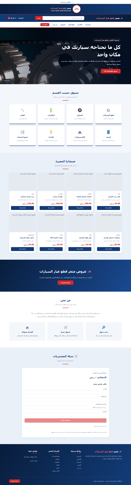
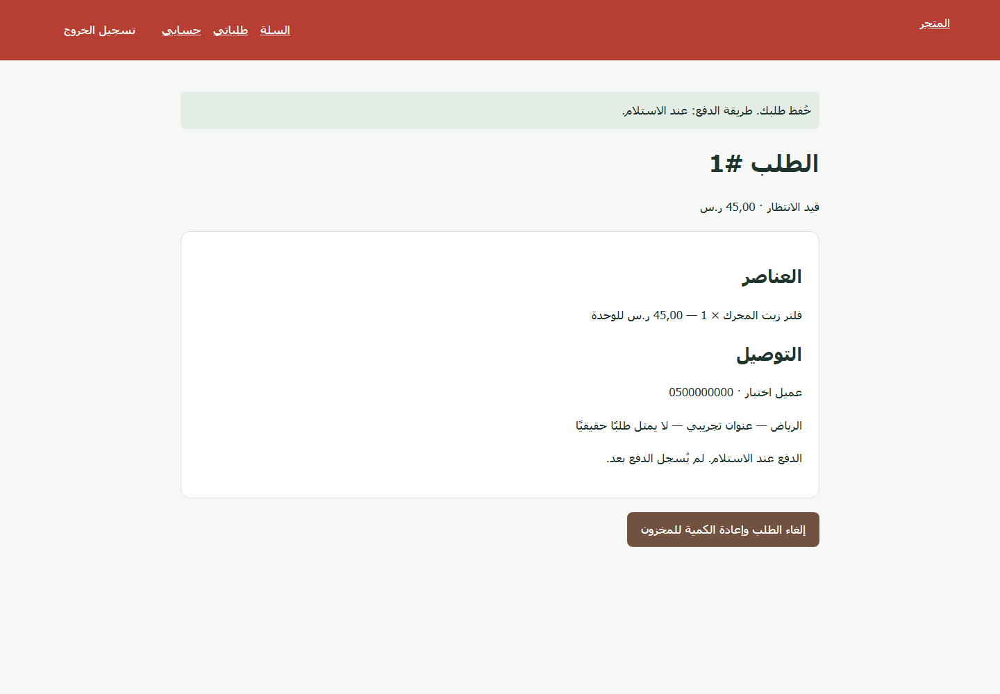

# Auto Parts Store — Django and JavaScript

## Overview

Arabic auto-parts storefront with search, a persistent browser cart, authenticated server-side checkout, stock control and saved vehicle details.

The customer-facing interface remains Arabic and RTL. This repository is independent; its current directory and GitHub repository name have not been changed.

## Features

- Existing Arabic layout, search, mobile navigation and cart interactions.
- Database catalog with authoritative product prices and stock.
- Signed-in cart import, transactional checkout and private order history.
- Vehicle/model information and delivery details saved with each order.
- Safe order cancellation and immutable purchased item details.
- Python assembly of standalone pages from shared HTML fragments.

## Tech Stack

- Python
- Django
- SQLite and Django ORM
- Native Django JSON endpoints
- HTML, CSS and JavaScript
- Pillow for product images
- python-dotenv
- Git

Testing uses Django's test runner and Playwright. The JSON endpoints, where present, use native Django views; Django REST Framework is not installed.

## Screenshots

All captures use fictional demonstration data. The home capture was taken with external requests blocked, so network-hosted product images are absent. The checkout capture needs refreshing after a label correction.

<details>
<summary>View verified interface screenshots</summary>






</details>

## Installation

Tested on Windows with Python 3.14 and Django 6.1.2. From this repository:

```powershell
python -m venv .venv
.\.venv\Scripts\python.exe -m pip install -r requirements.txt
```

On macOS/Linux, use `.venv/bin/python` in place of `.\.venv\Scripts\python.exe` in the commands below. No OS execution-policy change is required.

## Setup

`run_demo.py` creates a separate `.local/demo.sqlite3`, a locally generated development secret and fictional demo catalog/resources as appropriate. It never migrates the original root `db.sqlite3`. Re-running it preserves the demo database and does not reset existing records. No default customer or administrator password is shipped.

Direct Django commands read configuration from process environment and `.env` through `python-dotenv`. An optional local configuration file can be created without overwriting an existing one:

```powershell
if (-not (Test-Path .env)) { Copy-Item .env.example .env }
```

Keep real values in `.env` or process environment. `DJANGO_SECRET_KEY` must be persistent for ordinary long-running use. `DJANGO_DEBUG=0` requires an explicit secret and separate HTTPS/host/email configuration. `DJANGO_DB_PATH` selects a database for direct `manage.py` commands; do not point migration commands at personal data without first testing a backup.

## Running the Project

```powershell
.\.venv\Scripts\python.exe run_demo.py
```

Open **http://127.0.0.1:8103**. Register your own customer account.

```powershell
# Prepare the isolated demo without starting a server
.\.venv\Scripts\python.exe run_demo.py --prepare-only
# Interactively create an administrator in the isolated demo database
.\.venv\Scripts\python.exe run_demo.py --create-admin --prepare-only
```

The administrator URL is **`/admin/`**. The launcher supports `--port` and binds to localhost. Stop with Ctrl+C.

## Testing

```powershell
.\.venv\Scripts\python.exe -m pip install -r requirements-dev.txt
.\.venv\Scripts\python.exe -m playwright install chromium
.\.venv\Scripts\python.exe manage.py check
.\.venv\Scripts\python.exe manage.py test --noinput
.\.venv\Scripts\python.exe manage.py makemigrations --check --dry-run
.\.venv\Scripts\python.exe scripts/browser_check.py
```

Django tests use a test database. The browser check starts a temporary database and localhost server, creates disposable accounts and blocks external browser requests. It does not use the original or demo database. Outputs go to ignored `test-results/`.

The historical static-preview checks are also available as `python verify_site.py` and `python verify_contact.py`. They isolate their contact configuration and write screenshots to `test-results/`.

## Project Structure

- `accounts/` — Authentication, profile forms, routes and tests.
- `products/ and orders/` — Domain models, validation, services, routes and tests.
- `config/` — Django settings and root URLs.
- `templates/ and static/` — Arabic account and application pages.
- `scripts/browser_check.py` — Isolated end-to-end verification.
- `run_demo.py` — Non-destructive local demo launcher.
- `*.template.html, header.html, footer.html, build.py` — Source fragments and static page assembly.

## API

| Method | Route | Authentication / behavior |
|---|---|---|
| GET | `/api/session/` | Session state; sets a CSRF cookie |
| GET | `/api/catalog/` | Public available-product catalog |
| POST | `/api/cart/import/` | Signed-in cart import; rejects invalid codes, quantities and stock |

Example import payload: `{"items":[{"code":"PRODUCT_CODE","quantity":1}]}`. Use the actual code returned by the catalog. Checkout still happens through the HTML form routes below; prices are never accepted from the browser.

| Method | Route | Purpose |
|---|---|---|
| GET | `/orders/cart/` | Signed-in customer cart |
| POST | `/orders/cart/add/<product_id>/` | Add an available quantity |
| POST | `/orders/cart/update/<item_id>/` | Update an owned cart line |
| POST | `/orders/cart/remove/<item_id>/` | Remove an owned cart line |
| GET / POST | `/orders/checkout/` | Checkout form / transactional order placement |
| GET | `/orders/`, `/orders/<order_id>/` | Owned order history / detail |
| POST | `/orders/<order_id>/cancel/` | Cancel an eligible owned order |

| Method | Route | Response / purpose |
|---|---|---|
| GET / POST | `/accounts/signup/` | Registration form / account creation |
| GET / POST | `/accounts/login/` | Login form / session authentication |
| POST | `/accounts/logout/` | End the session |
| GET / POST | `/accounts/` | Read / update the signed-in profile |
| GET / POST | `/accounts/password/` | Validated password change |

Unsafe Django requests require a valid CSRF token and session where authentication is needed. Users can access only their own carts and orders; administration requires staff permissions.

## Data, Security and Scope

- Databases, `.env`, `.local/`, virtual environments, media uploads and test outputs are ignored by Git.
- Demo seeds add missing fictional catalog/resources; they do not create users or reset records.
- This is a local portfolio application, not a preconfigured public production deployment.
- No payment gateway, automatic WhatsApp/SMS delivery or production email service is configured.
- Checkout records cash-on-delivery/collection orders. Prices and stock are server-controlled; eligible unpaid pending cancellations restore quantities once.
- A standalone static preview retains the original browser-local interaction. Database-backed orders require the Django server.
- Run `python build.py` after editing templates/fragments. Existing external images/fonts may need internet access. Admin product codes must be positive numeric codes.

## Future Improvements

- Add compatibility attributes for vehicle make, model and year.
- Paginate the catalog API and expand filtering.
- Add PostgreSQL-backed concurrency tests and continuous integration.

## Source

[Auto Parts Store on GitHub](https://github.com/tayma-ops/math-). Maintenance notes: [PUBLISHING.md](PUBLISHING.md).

## Author

Atallah Alrashoud

GitHub: [tayma-ops](https://github.com/tayma-ops)
